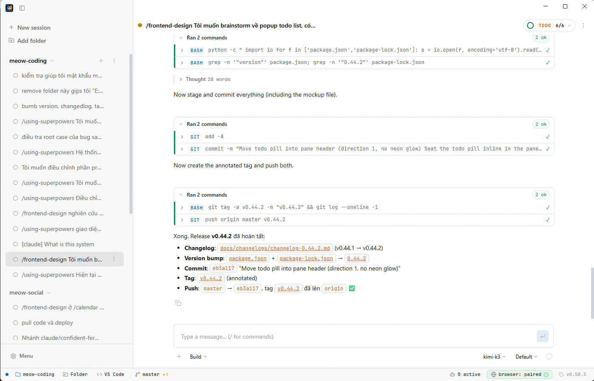
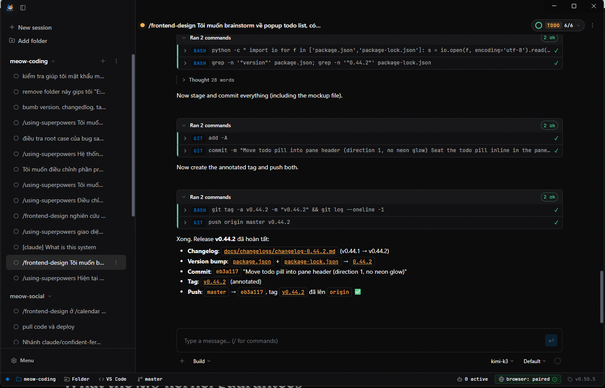

# Meow Coding

**Meow Coding** is a desktop app for running a built-in **native "Meow" agent** across multiple coding
**sessions** side by side — each session its own chat, in its own pane — inside a single window. The
agent ships with a chat UI, tool registry, sessions, permissions, skills, and a set of right-hand
panels (Files, Git, Tasks, Terminal, Browser, Sub-agents) that sit beside the chat.

**Latest release: v0.54.2** — see [`docs/changelogs`](docs/changelogs) for what changed.

<p align="center">
  
</p>

<p align="center">
  
</p>

## Highlights

- **Parallel sessions** — run several coding sessions in one window, each in its own pane, and switch
  between them from the sidebar. A session you are not looking at stays mounted and keeps running.
- **Native Meow agent** — a first-party coding agent with streaming output, markdown rendering,
  collapsible tool-call clusters, image attachments, and undo/redo.
- **Right-hand panels** — Files, Git, Tasks, Terminal, Browser and Sub-agents dock into one shared
  grid beside the chat, toggled from the title bar, resizable, and expandable over the whole pane.
- **Files & editing** — an in-app explorer with a lazy directory tree, name filter and `?` content
  search, preview/pinned tabs with syntax highlighting or rendered markdown, `Ctrl/Cmd+S` saves, and a
  gutter that sends a line to the chat.
- **Git panel** — read-only **Changes** and **History** tabs with inline diffs, push state
  (`↑N` unpushed, `↓N` behind, no-upstream), and live refresh while commits or files change.
- **Session terminals** — up to 8 shells per session with persisted scrollback; run a shell fence
  straight from the chat, or send the selection back to the composer.
- **Tasks panel** — background sessions, background shells, polled commands and delegations in one
  `Active` / `Finished` list with live output, stop and dismiss.
- **Built-in browser** — the default browser backend: per-session tabs inside the app, a
  console/network drawer, per-site approval, an agent shield, and `browser_handoff` for signing in.
  The Chrome extension bridge over a real Chrome profile remains available.
- **Chat that keeps you in control** — queued messages in their own card (send now / edit / remove),
  a context panel that breaks down what fills the window, a background tasks card that follows the
  feed, and a composer mascot that reacts to the turn.
- **Subagents & delegation** — `task` spawns isolated subagents, `delegate_session` creates a
  persistent sub-session nested in the sidebar (optionally on another model), and `delegate_cli` hands
  a focused task to the Antigravity CLI.
- **Slash commands** — `/init`, `/review`, `/new`, `/compact`, `/frontend-design`, plus custom commands
  with `$1..$N`, `$ARGUMENTS`, `@path` references and `` !`cmd` `` shell interpolation.
- **Bundled skills** — 6 skills loadable by the agent: 5 Anthropic front-end/design skills
  (`frontend-design`, `canvas-design`, `theme-factory`, `brand-guidelines`, `web-artifacts-builder`),
  and `katalon-studio`; project and user skills load alongside them.
- **Hooks & memory** — `PreToolUse` / `PostToolUse` / `Stop` hooks run your own policy outside the
  context window, and a per-project `.meow/memory/` store keeps durable notes across sessions.
- **MCP & LSP** — stdio and HTTP MCP servers, plus language-server diagnostics surfaced in the
  agent's edit tools.
- **Cost tracking** — token and dollar usage per session and per model via the models.dev catalog.
- **Office documents** — the native agent can create and edit `.docx`, `.xlsx`, and `.pptx` through
  the `office` tool (powered by OfficeCLI; binary auto-downloaded on first use).
- **Model Connections** — connect multiple Codex (ChatGPT OAuth) accounts, switch the active one,
  and keep API keys in the encrypted OS keychain (see below).
- **Browser bridge** — control a real Chrome profile through a loopback WebSocket bridge and an
  approved Chrome extension (MV3), with the same `browser_*` tools the built-in browser uses.
- **Updates you can see** — a new version downloads in the background and announces itself with a
  toast and a status-bar pill; checks run at startup, every 4 hours and after the machine wakes, and
  "Restart when ready" installs the moment the download finishes.

## What it's based on (Sources)

Meow Coding is built on open-source technology and openly credits its design influences:

- **opencode** — the native agent's feature set (slash commands, undo/redo, LSP diagnostics,
  compaction, cost tracking, MCP, skills, steering) is modeled on opencode's architecture. See
  `docs/superpowers/notes/2026-08-05-opencode-feature-diff.md` for the detailed feature comparison.
- **[obra/superpowers](https://github.com/obra/superpowers)** — the workflow conventions and planning
  design concepts behind the project's spec → plan → execute workflow (the bundled Superpowers skills
  and slash commands were dropped in v0.50.9; project and user skills are supported instead).
- **[anthropics/skills](https://github.com/anthropics/skills)** (Apache-2.0) — the front-end and
  design skills (frontend-design, canvas-design, theme-factory, brand-guidelines,
  web-artifacts-builder), bundled verbatim with their original `LICENSE.txt`.
- **[iOfficeAI/OfficeCLI](https://github.com/iOfficeAI/OfficeCLI)** (Apache-2.0) — the `office` tool
  for creating and editing Office documents.
- **[CLIProxyAPI](https://github.com/router-for-me/CLIProxyAPI)** (MIT) — wrapped by the
  `meow-cliproxy` sidecar that gives each Codex account its own scoped OpenAI-compatible proxy.
- **[@lydell/node-pty](https://github.com/microsoft/node-pty)** and **[xterm.js](https://xtermjs.org/)**
  — PTY and terminal rendering for the session terminal panel.
- **Electron, electron-vite, React, TypeScript, Vercel AI SDK** — the application shell and UI.

## Features

### Workspaces & sessions

- Add project folders as workspaces (persisted in `userData/workspaces.json`). Adding a project does
  not create a session: the project opens on a draft session, and the agent is materialized on the
  first prompt.
- The sidebar is a project group header (`+` new session, `…` project menu) with its sessions as
  indented rows carrying a status dot. `+` starts a draft session; its project is picked in the
  composer footer.
- A sub-session created by `delegate_session` is nested under the session that delegated it, and
  removing the parent removes its sub-sessions.
- The active session's status dot, name and `⋮` menu live in the window title bar, next to the panel
  toggles; the status bar carries the branch, its push state and the dirty-file count.
- Agents can run in the background; idle and exit alerts notify you, and per-agent logs are written to
  `userData/logs/<agentId>.log`.
- Closing the window hides to tray so sessions keep running; a second launch focuses the existing
  window instead of starting a duplicate.

### Native agent

- Full tool registry: `bash`, `bash_output`, `kill_shell`, `monitor`, `edit`, `write`, `read`,
  `apply-patch`, `glob`, `grep`, `git`, `question`, `todowrite`, `task` (subagents),
  `delegate_session`, `delegate_cli`, `delegate_result`, `revert`, `skill`, `webfetch`, `websearch`,
  `lsp`, `office`, and the `browser_*` tools (navigate, click, type, read, tabs, console, network,
  handoff, wait).
- Permission rules per tool: `allow` / `ask` / `deny` with wildcard patterns, "always allow"
  persistence, and a read-only **plan** mode.
- Context compaction with auto-continue, prune, and tool-output truncation to stay within budget;
  `/compact [focus]` summarizes on demand.
- Hooks (`PreToolUse` / `PostToolUse` / `Stop` and lifecycle events) configured in `meow.json` or
  `.meow/hooks.json`; they run outside the context window and can only tighten policy.
- Per-project memory in `.meow/memory/` with a `MEMORY.md` index injected at turn start.
- User tools loaded from `userData/tools`, and project `.meow/` directories for project-level
  commands, skills, subagent roles, hooks, memory, and AGENTS.md instructions.
- `AGENTS.md` / `CLAUDE.md` files are walked up from the working directory into the system prompt, and
  module-level ones attach automatically when a nearby file is read.
- The todo list stays honest: a stale-list nudge, an end-of-turn gate that refuses to finish with
  open items, and an automatic reset once every item is completed or cancelled.
- Failed turns persist as error cards with a **Retry** action when the failure is retryable.

### Chat & composer

- One rounded composer card: the auto-growing field on top and a bottom bar with the add menu, model
  picker, reasoning-effort picker and send/stop. The line under it holds the project folder, a branch
  chip that opens the Git panel, the context ring and the mode picker.
- A run of tool calls collapses into one line ("Read 2 files, edited a.ts, ran a command") with
  +N/−M counts; thinking folds into the same line as quiet steps.
- A shell fence in an assistant message renders as a command box with **Run in terminal** and
  **Copy command**.
- Questions render as the last feed row with Submit / Skip and optional free-text answers; the todo
  list renders as the final row too, so both scroll with the transcript.
- Messages sent while a turn runs are queued in their own card above the input, with send-now (or
  `Alt+Enter` for the first one), edit and remove.
- A **Background tasks** card appears at the bottom of the feed while the session is watching shells,
  polls or delegations, and opens the Tasks panel on the row you click.
- The context ring in the composer footer opens a panel with one row per bucket — system prompt,
  project instructions, memory, skills, tools, MCP tools, messages, free space — and a stacked bar.
- Paste or drop up to 4 images (≤5 MB each) into the composer.
- The calico mascot on the composer follows the turn (idle, think, type, sleep, happy, notify, error)
  and is decoration only.

### Right-hand panels

All six panels share one grid: cells fill column by column so a column is never half empty, the
column splitter sets the shared width (320–1600px, remembered across runs), a row splitter appears
wherever a column really splits, and `⤢` expands a panel over the whole pane area.

- **Files** — lazy directory tree (dotfiles and `node_modules` included), name filter and `?` content
  search, preview/pinned tabs with a CodeMirror editor or rendered markdown, a per-file bar with
  Raw/Highlighted, Fold all, Copy, Reveal and Open in VS Code. `Ctrl/Cmd+S` saves, unsaved tabs show a
  dot and ask before discarding, and a gutter `+` sends the line or selection to the composer.
- **Git** — read-only **Changes** (staged/changes, inline diff per file) and **History** (filter,
  commit list, inline commit detail with per-file diffs). Unpushed commits are marked, the branch chip
  and status-bar pill show `↑N`/`↓N`/no upstream, and the panel keeps itself live.
- **Tasks** — one card per background session, background shell, polled command or delegation,
  grouped `Active` / `Finished`, each with an identity badge (Meow, Users for a sub-session, Terminal
  for a shell, the Antigravity logo for a CLI run), elapsed time, live output or result, and
  stop/kill/dismiss actions. It replaces the old Processes overlay, Monitors pane and background strip.
- **Terminal** — up to 8 shell tabs per session (Git Bash, falling back to PowerShell, on Windows;
  `$SHELL`, falling back to bash, elsewhere), status dot and exit code, double-click rename, Restart,
  and a tab context menu. Terminals keep running while you switch sessions, scrollback survives a
  restart, and right-click offers Copy, Paste, Clear and Send Selection to Chat. Toggle with
  `` Ctrl/Cmd+` ``.
- **Browser** — per-session tabs, back/forward/reload and an address bar (bare hosts → `https://`,
  loopback → `http://`), a console/network drawer with Send to chat, a control banner with Take
  over / Hand back, and per-site approval for click/type/select. `Ctrl/Cmd+Shift+B` toggles it.
- **Sub-agents** — one tab per subagent run with its state, tool list, live text/reasoning and result.

### Providers & models

- Anthropic, Google, and any OpenAI-compatible endpoint.
- Model catalog from models.dev with provider/model browsing and per-agent model selection.
- Model variants (effort levels) and a "plan" vs "build" agent mode.
- Context and output limits resolved from overrides, learned values, live `/models` data and the
  catalog, with provider rejections tightening the learned limit.

### Model Connections (account management)

- **Codex (ChatGPT OAuth)**: connect multiple Codex accounts with PKCE OAuth in the Providers
  screen, pick the active account, and chat with its models. Chat requests run through an
  account-scoped local OpenAI-compatible proxy (`meow-cliproxy`, built on the MIT-licensed
  CLIProxyAPI), so a credential issued for one account can never route through another. Your real
  `~/.codex/auth.json` is never read or written.
- **Secrets**: OAuth access/refresh/ID tokens are stored only in the encrypted OS keychain
  (safeStorage); the metadata index under `userData/connections` holds non-secret account
  information only. Runtime proxy config is removed on shutdown and stale directories are cleaned
  at the next launch.
- **API key vault**: provider API keys stored encrypted in the OS keychain (safeStorage) instead of
  plaintext in settings; `keyRef` resolves at runtime.
- Codex is the only connection provider today (`ConnectionProviderId = 'codex'`); Claude Code OAuth
  is not supported yet.

### External delegation (Claude Code → Meow)

- **Settings → External delegation** enables a loopback API (off by default) so Claude Code can hand
  plan tasks to Meow.
- A dependency-free `meow-delegate` CLI (`start`, `send`, `models`, `status`, `wait`, `cancel`) is
  copied to `userData/bin/`; each plan gets its own visible `[claude] <plan>` session.
- `GET /v1/models` lists every configured model, and `POST /v1/tasks` accepts a free-form `model`
  request (`provider/model`, an exact id, or a name like `opus`) that resolves the same way
  `delegate_session`'s `model` argument does.
- **Install Claude skill** writes a `meow-delegate` skill to `~/.claude/skills/` that tells Claude to
  delegate task by task, verify the diff and tests itself, and send at most 3 feedback rounds.

### Updates

- A new version is announced in-app with a bottom-right toast ("vX is ready — Restart now / Later")
  and a status-bar pill that walks through **Update available → Updating N% → Restart to update**.
- The pill opens the update dialog, which shows the release notes, download progress and a state per
  phase; Settings → Updates mirrors the same controls.
- "Update & Restart" during a background download schedules the restart for the moment it finishes,
  with **Keep working** to cancel it.
- Checks run at startup, every 4 hours, and after the machine wakes from sleep; a failed background
  check retries after 5 minutes (at most twice per session).

### UI & desktop

- Frameless custom title bar (min / max / close) that also carries the session title and the panel
  toggles; collapsing the sidebar shrinks the brand strip so the title moves next to the expand
  button.
- Light & dark themes (VSCode Light+ / charcoal Studio Dark) with a Sun/Moon toggle in the sidebar;
  popups re-theme live, and the choice persists across restarts.
- Settings dialog with ten tabs: Sub-agents, Antigravity CLI, Providers, MCP, Permissions, Commands,
  Context, External delegation, Personalize, and Updates.
- Menus and dialogs share one surface with a faint rim; the session terminal is always dark.

## Architecture

Electron runs three isolated processes communicating over a centralized IPC contract, plus a
companion Chrome extension:

- **`src/main`** — Electron main process: stores, services, IPC handlers, and app lifecycle. The only
  place that spawns/kills processes. Also hosts the built-in browser and the Chrome bridge
  (`src/main/browser`), the session terminals (`terminal-manager.ts`), the Antigravity CLI runtime
  (`cli-agents/`), the loopback external-delegation API (`external-api/`), the updater, and the file
  watcher that attributes agent edits to artifacts.
- **`src/preload`** — context bridge exposing a typed `window.api` (implements `AgentApi`).
- **`src/renderer`** — React UI: sidebar with per-project session rows, session panes with the
  native-agent chat panel, and the docked right-hand panels (Files, Git, Tasks, Terminal, Browser,
  Sub-agents) laid out by `right-panels-layout.ts`.
- **`src/shared`** — shared types and the IPC contract (`Channels` + `AgentApi`); no Node/Electron
  imports here.
- **`src/browser-extension`** — Chrome MV3 extension (built separately with esbuild) that connects
  to the desktop browser bridge and is approved once in the app.

(The browser extension is not an Electron process; it connects to the desktop over WebSocket.)

Security: `contextIsolation: true`, `nodeIntegration: false`; the renderer never touches Node or
Electron directly.

## Requirements

- Node.js 20+
- Git
- A provider API key (Anthropic, Google, or any OpenAI-compatible endpoint), or a Codex account to
  connect

## Development

```bash
npm install
npx @electron/rebuild -f -w @lydell/node-pty   # Windows: rebuild native binding if missing
npm run dev                                    # start electron-vite dev
```

Other commands:

```bash
npm run build            # build (also builds the Chrome extension)
npm run start            # preview build
npm run build:extension  # build the Chrome extension only
npm run regen:models     # regenerate src/main/models-snapshot.json
npm run dist             # package Windows installer (NSIS + portable)
npm run dist:linux       # package Linux (AppImage + deb)
npm run dist:mac         # package macOS (dmg + zip; must run on macOS)
```

### CI / Releases

GitHub Actions (`.github/workflows/build.yml`) runs on every `v*` tag: it typechecks and tests, then
builds Windows (NSIS + portable, Azure Trusted Signing), macOS (dmg + zip, x64/arm64) and Linux
(AppImage + deb). The publish job attaches the artifacts to the GitHub release with
`docs/changelogs/changelog-<version>.md` as the release body — grab installers from the
[Releases](https://github.com/meow-home/meow-coding/releases) page.

## Testing

```bash
npm test                     # unit + integration (Vitest)
npm run typecheck            # tsc for node, web, and extension
npm run build && npm run e2e # Playwright smoke test
```

## Notes

- Quitting the app kills every running agent and session terminal, including child processes
  (tree-kill).
- Persistent data lives under `userData/`: workspaces, sessions, logs, commands, permissions,
  connections, delegations, terminal scrollback, and snapshots.
- Bundled skill assets (Anthropic skills) are Apache-2.0 and ship with their original license files
  under `resources/skills/`.
- The built-in browser's cookies live in the `persist:meow-browser` Chromium partition under
  `userData/Partitions/`; that is not a Chrome profile.
- The browser bridge binds `127.0.0.1` only and requires an approved extension id before accepting
  commands; the external-delegation API is loopback-only, off by default, and gated by a bearer
  token.
